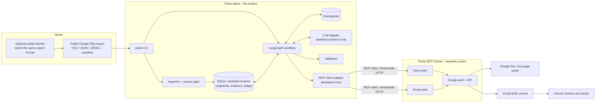
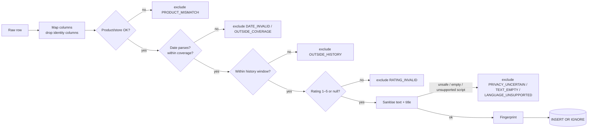
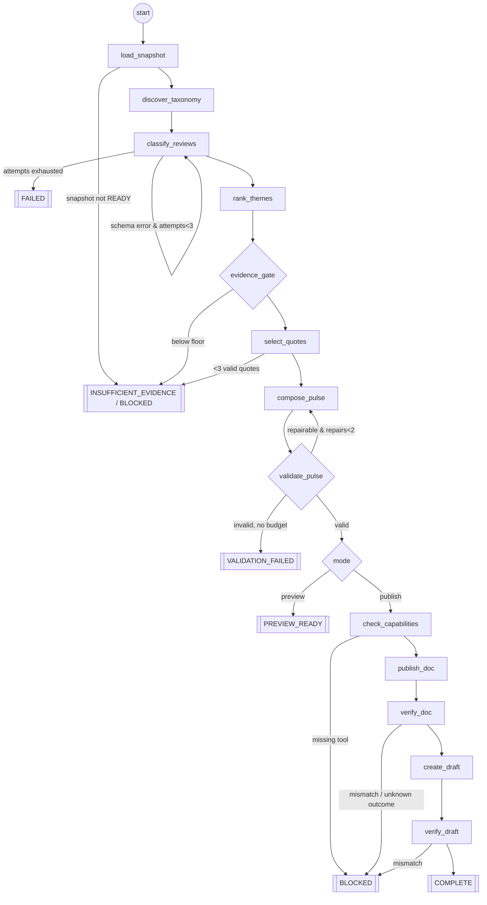

# Groww Weekly Review Pulse Agent — Architecture

**Requirements:** [problemStatement.md](problemStatement.md)
**Delivery plan:** [implementation-plan.md](implementation-plan.md)
**Operator setup and run checklist:** [input.md](input.md) — credentials, snapshot selection, preview, and publication prerequisites.
**Scope:** Google Play only (`com.nextbillion.groww`). Apple App Store deferred.
**Boundary:** This document covers the **Pulse Agent**. The **Pulse MCP Server** (Google Docs + Gmail tools) is a separate project. Section 9 defines the contract this agent requires from it.

---

## 1. Design Principles

1. **Code owns facts, the model owns language.** Dates, counts, rankings, quote text, word limits, recipients, and external writes are computed or enforced in code. The LLM proposes theme definitions, assigns themes, nominates quote spans, and drafts short summaries and actions. Every model output is validated against typed schemas and the evidence store.
2. **Privacy before persistence.** Raw review text exists only in memory during import. Nothing unsanitised reaches SQLite, checkpoints, logs, prompts, or output.
3. **Explicit agency.** The agent chooses its next step (retry, repair, stop, or block) only through declared conditional edges with numeric caps. There are no unbounded loops.
4. **Every run ends somewhere declared.** Terminal outcomes are enumerated upfront, and each carries a reason code and its last completed node.
5. **Side effects are idempotent and verified.** Each MCP write is preceded by a ledger intent and followed by read-back verification. Uncertain outcomes are reconciled, never blindly retried.
6. **Separable projects.** The agent depends on an MCP *contract*, not an implementation. With a mock server it is fully testable, and without any server it still produces a validated preview.

## 2. System Context



### 2.1 Responsibility split

| Concern | Pulse Agent | Pulse MCP Server |
| --- | --- | --- |
| Review data, privacy, analysis, content | ✅ | ❌ never sees raw reviews |
| Deciding what to publish, and when | ✅ | ❌ |
| Google OAuth, tokens, scopes | ❌ | ✅ |
| Google Docs / Gmail API calls | ❌ | ✅ |
| Tool schemas | Consumes and validates them | Defines and implements them per §9 |
| Refusing to send email | ✅ never calls send | ✅ should not expose send (defence in depth) |

## 3. Technology Choices

| Concern | Choice | Rationale |
| --- | --- | --- |
| Language/runtime | Python 3.12 (project-local via `uv`) | Typed ecosystem for LangGraph, MCP SDK, and spaCy. |
| Contracts | Pydantic v2, `extra="forbid"`, frozen models | Rejects unexpected fields from files, model output, and MCP responses. |
| Orchestration | LangGraph `StateGraph` | Explicit nodes and conditional edges, with built-in checkpointing. |
| Checkpoints | `langgraph-checkpoint-sqlite` (`SqliteSaver`) | Survives process restarts. `thread_id = run_id`. |
| Storage | SQLite (WAL mode, foreign keys on) | Single-operator workload, zero ops. PostgreSQL is a later option. |
| PII detection | Regex detectors plus spaCy `en_core_web_sm` PERSON NER | Local; no review text leaves the machine for sanitisation. |
| LLM | Claude Opus 5.5 via the `anthropic` SDK behind an `LLM` protocol. Structured JSON output, server-side refusal fallback. | Only sanitised text is sent, and the model has no tools. |
| MCP client | Official `mcp` Python SDK (`ClientSession`) | Standard tool discovery (`list_tools`) and invocation (`call_tool`). |
| CLI | `argparse` | No extra dependency. |
| Tests/lint | pytest, ruff | — |

Not needed: a vector DB, a queue, microservices, or a web UI.

## 4. Module Architecture

```text
src/groww_pulse/
  __init__.py, __main__.py
  cli.py                  # argparse entry: config, contract, fetch, import, snapshot, preview, publish, resume, inspect
  config.py               # RunConfig (immutable, validated) + YAML loader
  errors.py               # ErrorCode enum + PulseError (code-only messages)
  schemas.py              # Shared data contracts (manifest, reviews, snapshot, themes, pulse, state, ledger)
  ingestion/
    dates.py              # Reporting window + source-date parsing
    manifest.py           # Manifest loading/validation
    readers.py            # Streaming CSV / JSON / JSONL readers with size and row limits
    importer.py           # Row → mapped → validated → sanitised → stored; exclusion accounting
    fetcher.py            # Optional public fetcher → export file + manifest (Phase 1, opt-in)
  privacy/
    detectors.py          # Regex + NER detectors returning character spans
    sanitiser.py          # Redaction, safe-span attestation, language/script gate
  repository/
    db.py                 # Connection, migrations, transactions
    store.py              # Imports, reviews, snapshots (Phase 1); evidence + ledger (later)
  analysis/               # Phase 2: taxonomy, classification, ranking, quote selection
  composition/            # Phase 3: composer, renderer
  validation/             # Phase 3: cardinality, provenance, privacy, word count
  workflow/               # Phase 4: graph, nodes, routing, outcomes
  integrations/
    contract.py           # Required MCP tool contract + capability check (Phase 0)
    mcp_client.py         # Phase 5: session, allowlist, retries
    publisher.py          # Phase 5: docs/gmail operations with ledger + reconciliation
  llm/                    # Phase 2: provider-neutral structured-output adapter
  observability/          # Phase 4: allowlisted structured events
config/
  settings.example.yaml
  manifest.example.yaml
  mcp_contract.yaml       # Tools required from the Pulse MCP Server
  mcp_server.example.yaml # How to launch/connect to the server
tests/
  unit/ workflow/ contract/ privacy/ evaluation/ fixtures/   # Fictional data only
```

Dependency rule: `ingestion → privacy → repository` and `analysis/composition/validation → repository` (read-only). `workflow` composes everything, and `integrations` is called only from workflow publication nodes. No module imports `workflow`.

## 5. Ingestion Pipeline

### 5.1 Inputs

**Export file**: CSV (UTF-8/UTF-8-BOM), JSON array, or JSONL. It is streamed, never loaded whole: `csv.DictReader`, `ijson` for JSON arrays, and line iteration for JSONL. There are hard limits on file size (default 100 MB) and row count (default 100k).

**Manifest (YAML)**: declares where the export came from and what it covers.

```yaml
store: google_play
product_id: com.nextbillion.groww
provider_ref: google-play-public
acquisition_method: manual_public_export   # or permitted_public_export (fetcher)
public_export_confirmed: true
generated_at: 2026-10-06T09:00:00+05:30
coverage_start: 2026-07-27      # inclusive
coverage_end: 2026-10-05        # exclusive
coverage_status: complete_for_declared_export   # | sampled | unknown
storefront: IN
source_timezone: Asia/Kolkata
format: csv
date_precision: timestamp       # | date
date_format: iso8601            # | %Y-%m-%d | %d/%m/%Y
sort_order: newest
truncated: false
columns:
  text: content
  date: at
  rating: score
  title: null
  identity_columns: [userName, userImage, reviewId, replyContent, repliedAt, appVersion]
```

**Optional fetcher** (`pulse fetch`): uses a public, unauthenticated review listing for `com.nextbillion.groww` (language `en`, country `in`, sorted newest), paginating until it passes `history_start`. It writes `raw_exports/<date>.jsonl` and a matching manifest, then stops. It does **not** sanitise or store; the import step does. It is off by default, and the operator enables it explicitly after confirming it is permitted. The raw export directory is git-ignored and operator-owned.

### 5.2 Row pipeline



Exclusions are counted per `ErrorCode`. No excluded content is kept, and there is no quarantine file.

### 5.3 Time windows

Intervals are half-open (`start <= d < end`) in the reporting timezone (default `Asia/Kolkata`).

| Window | Definition |
| --- | --- |
| `report_end` | Monday 00:00 of the current week (the exclusive end of the latest complete week). |
| `report_start` | `report_end − 7 days`. |
| `history_start` | `report_end − history_weeks × 7 days` (default 10 weeks). |

Example: for a run on Fri 9 Oct 2026, the reporting week is Mon 28 Sep to Sun 4 Oct (`report_end` = 5 Oct), and history starts on 27 Jul.

Timestamped sources are converted to the reporting timezone. Date-only sources are accepted only when their source calendar equals the reporting timezone, so the agent never invents a time of day.

**Coverage check:** if the manifest's `[coverage_start, coverage_end)` does not include the whole reporting week, the snapshot outcome is `COVERAGE_MISSING`. That is different from a covered week with zero reviews (`EMPTY_WEEK`).

## 6. Privacy Design

### 6.1 Detectors (span-based)

| Detector | Examples caught | Method |
| --- | --- | --- |
| Email | `a.b@x.com` | Regex |
| URL / link | `https://…`, `www.…`, `bit.ly/…` | Regex |
| Phone | `+91 98xxxxxxxx`, `98765 43210`, 10-digit Indian mobiles | Regex on digit runs with separators |
| Handle | `@someone` | Regex |
| Long numeric ID | Account/order/client IDs, Aadhaar-like 12 digits (≥ 6 consecutive digits, allowing separators) | Regex. Plain amounts such as `₹5000` and `500` are kept because they are short. |
| PAN | `ABCDE1234F` | Regex |
| UPI ID | `name@okaxis` | Regex (covered by email/handle-style pattern `\w+@\w+`) |
| Person name | "Thanks **Rahul** from support" | spaCy PERSON entities, plus a self-identification pattern ("my name is X") |

Detectors return `(start, end, kind)` spans on the decoded source text. Overlapping spans are merged.

### 6.2 Redaction and safe spans

- Reviews with 8 words or fewer (after redaction) are excluded as `TEXT_TOO_SHORT` (`ingestion.min_review_words: 9`).
- Each detected span is replaced by the marker `[redacted]`. The marker is never counted as a quote word.
- `SafeText` keeps the redacted `evidence_text`, a whitespace-normalised `analysis_text`, and **safe spans**: maximal runs of `evidence_text` that are byte-identical to the source, with their source offsets. These are attested **before the raw text is discarded**. A later quote is valid only if it falls entirely inside one safe span, which guarantees verbatim wording without storing the original.
- A row is excluded as `PRIVACY_UNCERTAIN` when redactions cover > 40% of characters, or when no safe span ≥ 3 words remains.
- Removed values are never stored, hashed, or logged.

### 6.3 Language and script gate

The English privacy pipeline is the only validated one. Imports now reject emoji-bearing reviews and use a local Lingua English classifier (top language English with confidence at least 0.5), reject non-Latin mixed script, and reject common Romanised Hindi markers. Non-English or uncertain language is excluded with `LANGUAGE_UNSUPPORTED`; emoji is `EMOJI_REVIEW`. This conservative heuristic can reject valid English and cannot perfectly identify all code-switching. Text is never translated or stripped to manufacture a quote. Sanitiser version 2 marks the new policy; old imports require a refresh before analysis.

### 6.4 Boundaries scanned in tests

The database, checkpoints, logs/events, captured LLM payloads (test harness), preview artifacts, the MCP request payloads (mock server), and the Doc/draft read-backs are all scanned with the same detectors against planted canary PII.

## 7. Data Model (SQLite)

```sql
CREATE TABLE imports (
  import_id TEXT PRIMARY KEY, created_at TEXT NOT NULL,
  store TEXT NOT NULL CHECK (store = 'google_play'), product_id TEXT NOT NULL,
  manifest_json TEXT NOT NULL,           -- manifest minus any file paths
  counts_json TEXT NOT NULL, sanitiser_version TEXT NOT NULL
);
CREATE TABLE reviews (
  review_id TEXT PRIMARY KEY, fingerprint TEXT NOT NULL UNIQUE,
  first_import_id TEXT NOT NULL REFERENCES imports(import_id),
  review_date TEXT NOT NULL, date_precision TEXT NOT NULL,
  rating INTEGER CHECK (rating BETWEEN 1 AND 5),
  title_json TEXT, text_json TEXT NOT NULL,   -- SafeText (sanitised)
  language TEXT NOT NULL, sanitiser_version TEXT NOT NULL
);
CREATE TABLE snapshots (
  snapshot_id TEXT PRIMARY KEY, import_id TEXT NOT NULL REFERENCES imports(import_id),
  snapshot_hash TEXT NOT NULL, window_json TEXT NOT NULL, counts_json TEXT NOT NULL,
  source_status TEXT NOT NULL, outcome TEXT NOT NULL, created_at TEXT NOT NULL
);
CREATE TABLE snapshot_members (
  snapshot_id TEXT NOT NULL REFERENCES snapshots(snapshot_id),
  review_id TEXT NOT NULL REFERENCES reviews(review_id),
  in_report_week INTEGER NOT NULL,
  PRIMARY KEY (snapshot_id, review_id)
);
-- Phase 2+
CREATE TABLE taxonomies (taxonomy_id TEXT PRIMARY KEY, snapshot_id TEXT REFERENCES snapshots, version TEXT, themes_json TEXT, model_ref TEXT, prompt_version TEXT);
CREATE TABLE assignments (snapshot_id TEXT, review_id TEXT, taxonomy_id TEXT, theme_id TEXT, PRIMARY KEY (snapshot_id, review_id, taxonomy_id));
CREATE TABLE pulses (pulse_id TEXT PRIMARY KEY, run_id TEXT, snapshot_id TEXT, pulse_json TEXT, rendered TEXT, word_count INTEGER, content_hash TEXT);
-- Phase 4–5
CREATE TABLE runs (run_id TEXT PRIMARY KEY, snapshot_id TEXT, mode TEXT, status TEXT, reason_code TEXT, last_node TEXT, started_at TEXT, completed_at TEXT);
CREATE TABLE external_operations (operation_key TEXT PRIMARY KEY, run_id TEXT, kind TEXT, payload_hash TEXT, target_ref TEXT, status TEXT, attempts INTEGER, safe_error TEXT, updated_at TEXT);
CREATE TABLE publication_receipts (publication_key TEXT PRIMARY KEY, run_id TEXT, document_id TEXT, document_url TEXT, doc_hash TEXT, draft_id TEXT, draft_hash TEXT, layout_status TEXT, verified_at TEXT);
```

- **Fingerprint** = SHA-256 of `store | product | review_date | rating | sanitised title | sanitised text`. The *n*-th identical row within one export gets `sha256(fingerprint:n)`. Many people post the same short text ("Good app") on the same day; about 29% of the real export is like this. Those are distinct reviews and must be counted, not collapsed. Re-importing the same export reproduces the same ordinals, so it inserts nothing. Limitation: two overlapping exports that disagree on how many identical reviews a day had will reconcile to the larger number only if that export is imported.
- **Snapshot** = the frozen set of review IDs inside `[history_start, report_end)`, with a `snapshot_hash` over the sorted fingerprints and window. Later imports never change an existing snapshot.
- Raw filenames, reviewer identifiers, and removed values are never stored.

## 8. Agent Workflow (LangGraph)

### 8.1 State

All inter-node data flows through this typed state, so nothing passes between nodes outside it. Large data is held by reference (IDs into SQLite) to keep checkpoints small and PII-free.

```text
PulseState
  run_id, mode (preview|publish), snapshot_id, config_hash, report_start, report_end
  taxonomy_id?, theme_ranking[] (theme_id, count, share), eligible_weekly_count
  quote_ids[], action_ids[], pulse_id?, word_count?, content_hash?
  attempts: {classify, compose, mcp_read, mcp_write}
  validation_errors[] (codes only)
  capability_status?, document_id?, document_url?, draft_id?
  layout_status?, draft_status?
  status, reason_code?, last_completed_node, terminal: bool
```

### 8.2 Graph



### 8.3 Nodes (one job each, testable alone)

| Node | Reads | Writes | Notes |
| --- | --- | --- | --- |
| `load_snapshot` | snapshot | window, counts | Routes on snapshot outcome. |
| `discover_taxonomy` | sanitised history (deterministic stratified sample ≤ 300 reviews) | `taxonomy_id` | LLM proposes ≤ 5 themes. Code enforces the cap and IDs. |
| `classify_reviews` | all reporting-week reviews, in batches of 40 | assignments | Every eligible weekly review must receive exactly one known theme. History is used only for taxonomy discovery. |
| `rank_themes` | assignments | ranking | Pure code: count desc, then theme_id. |
| `evidence_gate` | ranking | — | Conditional edge: ≥ 10 weekly reviews, top-3 each ≥ 2. |
| `select_quotes` | top-3 theme reviews | quote IDs | LLM nominates up to 5 excerpts copied from reviews. Code locates each in the stored text and verifies it against safe spans (6–40 words, no `[redacted]`). A deterministic first-verifiable-sentence fallback applies if all picks fail. |
| `compose_pulse` | ranking, quotes, coverage | pulse draft | LLM writes 3 short summaries + 3 actions linked to evidence. Code renders. |
| `validate_pulse` | pulse | errors | Cardinality, provenance, privacy, ≤ 250 words, no placeholders. |
| `check_capabilities` | MCP `list_tools` | capability status | Compared with `config/mcp_contract.yaml`. |
| `publish_doc` / `verify_doc` | rendered note | doc id/url | Ledger intent → call → read-back → hash compare. |
| `create_draft` / `verify_draft` | rendered note + doc url | draft id | Same ledger pattern. Unsent status verified. |

### 8.4 Conditional edges and caps

| Edge | Condition | Cap |
| --- | --- | --- |
| classify retry | Schema/ID validation failed | 3 attempts per batch |
| evidence gate | Weekly eligible ≥ 10, and top-3 themes each ≥ 2 reviews | — |
| quote fallback | Nominated span invalid → next candidate | 5 candidates per theme |
| compose repair | Over-length, placeholder, or missing evidence link | 2 repairs after the initial attempt |
| MCP read retry | Transient error | 3 attempts, exponential backoff with jitter |
| MCP write retry | Only when the failure is confirmed non-applied | 3 attempts. Otherwise reconcile. |
| Whole run | Active time | 15 minutes |

### 8.5 Terminal outcomes

| Outcome | Meaning |
| --- | --- |
| `PREVIEW_READY` | A validated local pulse exists. No external writes were made. |
| `COMPLETE` | The Doc and the unsent draft are created and verified. |
| `INSUFFICIENT_EVIDENCE` | Too few reviews, themes, or quote-safe spans. |
| `VALIDATION_FAILED` | The pulse is still invalid after repairs. |
| `BLOCKED` | Needs a human: missing MCP capability, unknown write outcome, missing coverage, or layout check. |
| `FAILED` | Permanent error or exhausted retries. |

Each records `reason_code`, `last_completed_node`, attempts, and any external resource IDs.

### 8.6 Checkpointing and resume

`SqliteSaver` persists state after every node with `thread_id = run_id`. `pulse resume <run_id>` continues from the last completed node. LLM outputs are stored in SQLite (taxonomy, assignments, pulse), so a resume never regenerates prose that has already been validated.

## 9. MCP Tool Contract (required from the Pulse MCP Server)

This is the interface the separate MCP Server project must implement. Names and schemas are proposed and should be agreed with the MCP project. The agent validates the live server's `list_tools` output against `config/mcp_contract.yaml` before any write.

### 9.1 Required tools

| Tool | Input | Output | Purpose |
| --- | --- | --- | --- |
| `docs_create_document` | `title: str`, `marker: str` | `{document_id, url}` | Create an empty Doc tagged with an idempotency marker. |
| `docs_write_content` | `document_id`, `content_markdown: str` | `{document_id, revision_id}` | Replace the body with the rendered note (headings, numbered lists, bullets). |
| `docs_get_document` | `document_id` | `{document_id, title, text, url, revision_id}` | Read-back for verification. |
| `docs_find_by_marker` | `marker` | `{documents: [{document_id, title, url}]}` | Reconcile after an uncertain create. |
| `gmail_create_draft` | `to: str`, `subject: str`, `body_text: str`, `marker: str` | `{draft_id, message_id}` | Create an **unsent** draft. |
| `gmail_get_draft` | `draft_id` | `{draft_id, to, subject, body_text, is_draft: bool}` | Read-back, including unsent status. |
| `gmail_find_drafts` | `marker` | `{drafts: [{draft_id, subject}]}` | Reconcile after an uncertain create. |

### 9.2 Optional tools

| Tool | Purpose | If absent |
| --- | --- | --- |
| `docs_get_page_count` | Verify the one-page layout (e.g. via PDF export). | Layout status `MANUAL_CHECK_REQUIRED`. `pulse publish` then completes with an operator confirmation step. |
| `gmail_update_draft` | Update an application-owned, unmodified draft for a revision. | Block on revision; never overwrite. |

### 9.3 Forbidden tools (never called, even if exposed)

`gmail_send*`, `*send_draft*`, `*forward*`, `*delete*`, `*share*`, and `*permission*`. The client adapter enforces an allowlist built from §9.1 and §9.2. Any other tool name is unreachable from the agent.

### 9.4 Transport and configuration

```yaml
# config/mcp_server.yaml (example; real file is git-ignored)
transport: stdio            # or streamable_http
command: python             # stdio: how to launch the Pulse MCP Server
args: ["-m", "pulse_mcp_server"]
url: null                   # streamable_http: e.g. http://127.0.0.1:8765/mcp
timeout_seconds: 30
recipient_env: PULSE_DRAFT_RECIPIENT   # read only inside the publisher; never in state/prompts/logs
```

### 9.5 Idempotency markers

`marker = "groww-pulse:" + publication_key[:16]`, where `publication_key = sha256(product | report_start | report_end | revision)`. The marker goes into Doc/draft metadata (or a short footer if the server can only search text). A footer is included in the word count.

## 10. Publication Ledger and Recovery

1. Before a write, insert `external_operations(operation_key, kind, payload_hash, status=PENDING)`.
2. Call the tool. On success, record `target_ref`, read the resource back, compare hashes, and mark `VERIFIED`.
3. On a timeout or lost response, mark `UNKNOWN_OUTCOME`, then call `*_find_by_marker`. Exactly one match whose content verifies is adopted. Zero or multiple matches end the run as `BLOCKED / RECONCILIATION_REQUIRED`.
4. If the Doc is verified but the draft fails, a resume starts at `create_draft` and reuses the Doc.
5. If a Doc or draft was changed by a human since our last write hash, stop and never overwrite.
6. MCP responses are filtered to the fields in §9.1 before persistence, because connector metadata may contain account details.

## 11. LLM Boundary

- Inputs are sanitised `analysis_text`, review IDs, and theme IDs only. They never include recipients, URLs, or config.
- Outputs use strict JSON schemas (Pydantic). Unknown IDs, extra fields, a sixth theme, or a missing assignment are rejected.
- The model has **no tools**, so review text that contains instructions cannot cause actions. Prompts state that review text is data.
- The budget is enforced per run (input/output tokens). When it is exceeded, the run ends as `FAILED / BUDGET_EXCEEDED`, never with silent sampling of weekly counts.
- Prompt and model versions are stored with every derived artifact.

## 12. Pulse Rendering

```text
Groww Weekly Review Pulse | 28 Sep – 4 Oct 2026
Coverage: {N} Google Play reviews this week ({excluded} excluded across the export) | history {H} weeks

Top themes
1. {Theme} — {count}/{N} reviews. {≤ 25-word supported summary}
2. …
3. …

What users said
• "{verbatim excerpt}" — anonymous Google Play review
• …
• …

Action ideas
1. {Concrete next step for theme 1}
2. …
3. …
```

- Word count uses one Unicode-aware tokenizer (`\w+(?:['’-]\w+)*`) across **all** visible text. The hard maximum is 250 and the target is 200–230.
- The renderer never truncates. Over-length triggers a compose repair of summaries and actions only. Approved quotes remain fixed; if the note still cannot fit, it ends as `VALIDATION_FAILED`.
- The email body is a two-line wrapper, the full note, and the Doc link. The wrapper is outside the 250-word note budget.

## 13. Configuration

```yaml
reporting: { timezone: Asia/Kolkata, history_weeks: 10, period: latest_complete_week }
analysis:  { max_themes: 5, highlighted_themes: 3, min_reviews_per_highlighted_theme: 2, min_weekly_reviews: 10, quotes: 3, actions: 3 }
output:    { max_words: 250, max_pages: 1, email_mode: draft_only }
execution: { model_batch_attempts: 3, composition_repairs: 2, safe_mcp_attempts: 3, active_run_timeout_minutes: 15 }
privacy:   { spacy_model: en_core_web_sm, max_redaction_ratio: 0.4 }
model:     { provider: openai, model: <chosen in Phase 2>, max_input_tokens_per_run: 100000 }
storage:   { database: data/pulse.sqlite3, max_input_bytes: 100000000, max_rows: 100000 }
```

Validation rejects any store other than Google Play, other product IDs, history outside 8–12 weeks, raising mandatory limits (themes > 5, words > 250), and any email mode other than `draft_only`. Secrets (LLM API key, recipient) come from environment variables only.

## 14. CLI

| Command | Phase | Effect |
| --- | --- | --- |
| `pulse config check [--config]` | 0 | Validate config, print the reporting window. |
| `pulse contract check --tools tools.json` | 0 | Validate a captured `list_tools` dump against the contract. |
| `pulse fetch --out raw_exports/` | 1 | Optional public fetch → export + manifest. |
| `pulse import --manifest m.yaml --file f` | 1 | Sanitise and store, then print content-free counts. |
| `pulse snapshot [--as-of DATE]` | 1 | Freeze a snapshot and print its outcome and counts. |
| `pulse preview` | 3–4 | Run the graph in preview mode, writing `artifacts/<run>/pulse.md`, `evidence.json`, and `validation.json`. |
| `pulse publish` | 5 | Run in publish mode via MCP. |
| `pulse resume <run_id>` / `pulse inspect <run_id>` | 4 | Resume / show status. |

Exit codes: `0` success/preview, `2` invalid input/config, `3` insufficient evidence, `4` blocked, `1` failure. Errors print only `ErrorCode` values.

## 15. Observability

Events are allowlisted: run_id, node, status, counts, durations, attempts, token totals, operation status, and reason code. There is no prompt or response tracing, and exceptions are mapped to codes before logging. Logs are written as JSONL in `data/logs/`.

## 16. Security

- Review text is untrusted. It never influences tools, recipients, or routing, and the model has no tools.
- The recipient is resolved only inside the publisher, from an environment variable.
- The tool allowlist makes send/share unreachable.
- Raw exports, the DB, and artifacts are git-ignored. Database files inherit host file permissions.
- Retention defaults: sanitised reviews 90 days, checkpoints 30 days, logs 30 days, and no retention of raw exports by the app.

## 17. Testing Strategy

| Layer | What is tested |
| --- | --- |
| Unit | Config validation, date windows, readers, detectors, sanitiser spans, fingerprinting, ranking, word count, renderer. |
| Privacy | Canary PII planted in fixtures. Scans of DB, checkpoints, logs, captured payloads, and artifacts. |
| Workflow | Each node alone. Each conditional edge forced both ways. Caps hit. Interrupt/resume after each node. |
| Contract | Fake MCP server (in-process) implementing §9. Missing tool → BLOCKED. Forbidden tool never called. Timeout → reconcile. |
| Evaluation | 60–100 labelled sanitised reviews: theme agreement ≥ 85%, 100% quote validity, 100% count accuracy. |
| Acceptance | One real week end-to-end against the real Pulse MCP Server. AC-01…AC-12 evidence. |

## 18. Requirement Traceability

| Requirement | Sections | Phase |
| --- | --- | --- |
| FR-01 acquisition | 5 | 0–1 |
| FR-02 privacy | 6, 7, 15, 16 | 1 (+ every boundary) |
| FR-03 themes | 8.3, 11 | 2 |
| FR-04 pulse | 8.3, 12 | 2–3 |
| FR-05 MCP publication | 9, 10 | 0 (contract), 5 |
| FR-06 agentic control | 8 | 4 |
| FR-07 CLI | 14 | 0–5 |

## 19. Open Inputs Before Acceptance

1. The agreed tool contract (§9) is implemented by the Pulse MCP Server project.
2. The LLM provider/model choice and API key.
3. The draft recipient address (self or alias).
4. A compliant Google Play export, or explicit operator approval to use the optional public fetcher.
5. The layout verification method (`docs_get_page_count` or a recorded manual check).
