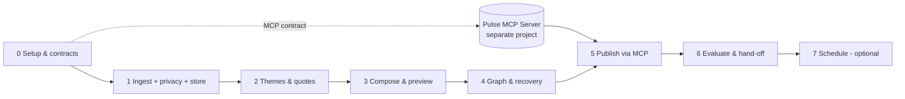

# Groww Weekly Review Pulse Agent — Phase-wise Implementation Plan

**Requirements:** [problemStatement.md](problemStatement.md) · **Design:** [architecture.md](architecture.md)
**Scope:** The Pulse Agent only. The Pulse MCP Server (Docs + Gmail) is a separate project. This plan delivers the agent and the tool contract it needs from that server.
**Source:** Google Play only. Apple App Store deferred.

**Inputs and operator steps:** [input.md](input.md) is the checklist for Groq credentials, the existing snapshot, preview/resume commands, and deferred MCP setup. Follow it for running the current implementation. Further implementation phases remain on hold until the user requests them.

| Phase | Status |
| --- | --- |
| 0 — Setup, config, contracts | ✅ Implemented |
| 1 — Acquisition, privacy, storage, snapshots | ✅ Implemented |
| 2 — Themes, ranking, quote evidence | ✅ Implemented; live Groq run done |
| 3 — Composition and local preview | ✅ Implemented; live preview `PREVIEW_READY` (219 words) |
| 4 — LangGraph workflow, checkpoints, outcomes | ✅ Implemented; persistent resume tested |
| 5 — MCP publication (Docs + Gmail) | ✅ Implemented; live direct send completed 18 Oct 2026 |
| 6 — Evaluation and hand-off | ✅ Implemented; live acceptance run recorded |
| 7 — Optional weekly scheduling | ⬜ Optional |

---

## Phase Overview

Phases 0–4 need **no** Google account and **no** MCP server. Phase 5 needs a running Pulse MCP Server that implements the contract (architecture §9). Until then, Phase 5 is developed against an in-process fake server.

Rules that hold in every phase:

- Fictional fixtures only in tests. Real reviews never enter the repo.
- No review text, filenames, or identifiers in logs or errors (codes and counts only).
- Every phase ends with `ruff check` and `pytest` green.

---

## Phase 0 — Environment, Configuration, Contracts ✅

**Goal:** a runnable, typed skeleton with validated defaults and a written contract for the MCP Server project.

### Tasks

- [x] Project-local Python 3.12 via `uv` (`.tools/`, `.venv/`), `pyproject.toml`, and `src/` layout.
- [x] `.gitignore` covering the venv, caches, `data/`, `raw_exports/`, `artifacts/`, `.env`, and SQLite files.
- [x] `errors.py`: an `ErrorCode` enum and a `PulseError` that carries only a code.
- [x] `config.py`: immutable `RunConfig` (product, reporting, analysis, output, execution, privacy, model, storage) and a YAML loader. It rejects non-Google-Play stores, wrong product IDs, history outside 8–12 weeks, more than 5 themes, more than 250 words, and any email mode other than `draft_only`.
- [x] `schemas.py`: manifest, column mapping, reporting window, safe spans/text, sanitised review, snapshot, taxonomy, quote, action, pulse, run status/state, and external operation.
- [x] `ingestion/dates.py`: the reporting window (latest complete Mon–Sun week, half-open) and source-date parsing.
- [x] `integrations/contract.py` + `config/mcp_contract.yaml`: required, optional, and forbidden MCP tools, plus a checker for a captured `list_tools` dump.
- [x] Example configs: `config/settings.example.yaml`, `config/manifest.example.yaml`, `config/mcp_server.example.yaml`.
- [x] `cli.py`: `pulse config check`, `pulse contract check`.
- [x] README with setup and commands.

### Exit checks

- [x] `python -m groww_pulse config check` prints the reporting window.
- [x] Invalid config (wrong store/product, 13 weeks, 6 themes, a send mode) fails with `CONFIG_INVALID`.
- [x] A contract check against a tools dump that lacks a required tool reports `CAPABILITY_UNAVAILABLE`. Forbidden tools are listed as ignored.
- [x] Unit tests for config, dates, and the contract.

### Hand-off to the MCP Server project

Share architecture §9 and `config/mcp_contract.yaml`. That project implements the tools. This project only consumes them.

---

## Phase 1 — Acquisition, Privacy, Storage, Snapshots ✅

**Goal:** a reproducible, sanitised, immutable dataset with honest coverage accounting, before any model call.

### Tasks

- [x] `ingestion/manifest.py`: load and validate the YAML manifest.
- [x] `ingestion/readers.py`: streaming CSV / JSON array (`ijson`) / JSONL readers with file-size and row limits.
- [x] `privacy/detectors.py`: email, URL, phone, handle, long numeric ID, PAN, and person-name (spaCy PERSON + self-identification pattern) detectors returning spans.
- [x] `privacy/sanitiser.py`: merges spans, redacts as `[redacted]`, builds safe spans mapped to source offsets, applies the script/language gate and redaction-ratio exclusion, and normalises analysis text.
- [x] `repository/db.py`: SQLite connection (WAL, foreign keys) and schema migrations.
- [x] `repository/store.py`: imports, reviews (`INSERT OR IGNORE` on fingerprint), snapshots, and snapshot members.
- [x] `ingestion/importer.py`: row pipeline (map → drop identity → product → date → window → rating → sanitise → fingerprint → store) with per-code exclusion counts.
- [x] Snapshot creation: window membership, report-week flag, coverage check (`READY` / `EMPTY_WEEK` / `NO_ELIGIBLE_REVIEWS` / `COVERAGE_MISSING`), and hash.
- [x] `ingestion/fetcher.py` (optional, opt-in): public review listing → JSONL export + manifest. Never sanitises or stores.
- [x] CLI: `pulse fetch`, `pulse import`, `pulse snapshot`.

### Exit checks

- [x] Fixtures cover missing title/rating, invalid dates, a wrong product, out-of-window rows, Devanagari text, empty text, malformed rows, and an empty file.
- [x] Re-importing the same file inserts 0 new rows (counts are not inflated). Similar but distinct reviews remain distinct.
- [x] Planted canary PII (emails, phones, URLs, handles, IDs, names, identity columns) is absent from the whole SQLite file.
- [x] Boundary dates: a review on `report_end` falls outside the week, and one on `report_start` falls inside it.
- [x] Coverage that misses the report week → `COVERAGE_MISSING`. A covered week with no reviews → `EMPTY_WEEK`.

**Milestone M1:** `pulse import` then `pulse snapshot` produces a sanitised snapshot without any network call, model call, or Google access.

### Phase 1 result on real data (fetched 9 Oct 2026)

| Step | Count |
| --- | --- |
| Public reviews fetched (en, IN, newest first, back to 25 Jul) | 11,800 |
| Eligible after the privacy gate | 11,081 |
| Excluded: no text left (emoji/blank) / non-Latin script / ambiguous after redaction / before coverage | 264 / 132 / 230 / 93 |
| Reviews with at least one `[redacted]` identifier | 358 |
| Snapshot: history (27 Jul – 4 Oct) / reporting week (28 Sep – 4 Oct) | 10,499 / 808 |
| Week by rating: 1★ 2★ 3★ 4★ 5★ | 73 / 9 / 19 / 73 / 634 |
| Re-import of the same file | 0 inserted |
| Residual emails / phones / URLs in stored text | 0 / 0 / 0 |

Two fixes came from the real run. First, short clean reviews ("good app") are kept; the minimum-words rule now applies only to redacted reviews, and quote length is enforced in Phase 2. Second, identical reviews from different people are counted separately rather than collapsed.

---

## Phase 2 — Theme Discovery, Ranking, Quote Evidence ✅

**Goal:** auditable evidence for the pulse: ≤ 5 themes, every weekly review assigned, counted ranking, and verified quotes.

### Decisions made while implementing

- **Groq option (12 October 2026):** `llm/groq_llm.py` and a provider factory support the official Groq SDK using `GROQ_API_KEY`. `config/settings.groq.example.yaml` selects `openai/gpt-oss-120b`; `openai/gpt-oss-20b` is also supported. Strict JSON requests are followed by local validation against the original schema. Provider-specific defaults, token/cost accounting, safe error mapping and bounded SDK retries are implemented. The CLI loads `.env` without overriding the environment. A live Groq run remains pending the user's key; start a new Groq run rather than resuming an Anthropic run with changed config.
- **Model:** Claude Opus 5.5 (`claude-opus-5-5`) via the official `anthropic` SDK, with structured JSON output and server-side refusal fallback (`fallbacks: "default"`). Effort is `low` for classification and `medium` for taxonomy and quotes. Analysis code depends only on the `llm.base.LLM` protocol.
- **Review filter (requested):** only English reviews with **more than 8 words**, with no emoji anywhere in the retained body, are kept (`ingestion.min_review_words: 9`). Shorter ones are excluded at import as `TEXT_TOO_SHORT`.
- **Scope of classification:** only the reporting week is classified, because ranking is weekly. The history window feeds taxonomy discovery through a deterministic sample (≤ 300, stratified by week × rating, always including some report-week reviews).
- **Quotes:** the model returns an excerpt copied from a review (not character offsets). Code locates it in the stored text, tolerating only whitespace differences, and accepts it only if it lies inside one safe span, contains no `[redacted]`, and is 6–40 words. If every pick fails, a deterministic fallback takes the first verifiable sentence of a candidate review.
- **Catch-all theme:** allowed (at most one) and counted in the denominator, but never highlighted.

### Tasks

- [x] `llm/base.py`: the `LLM` protocol, plus a per-run `Budget` (input/output tokens and cost) that is checked before and after every call.
- [x] `llm/anthropic_llm.py`: structured output, refusal fallback, and SDK errors mapped to safe codes (`LLM_AUTH_FAILED`, `LLM_UNAVAILABLE`, `LLM_REFUSED`, `LLM_OUTPUT_INVALID`).
- [x] `analysis/corpus.py`: loads the snapshot and builds the deterministic discovery sample.
- [x] `analysis/taxonomy.py`: 3–5 themes, validated with Pydantic, unique IDs, ≤ 1 catch-all, retried up to 3 attempts, otherwise `TAXONOMY_INVALID`.
- [x] `analysis/classify.py`: batches of 40 with short positional IDs and a schema enum of theme IDs. Invented IDs and unknown themes are ignored. Only missing reviews are retried, up to 3 attempts, otherwise `CLASSIFICATION_FAILED`. Batches run in a thread pool (≤ 2) and each one is persisted as it finishes.
- [x] `analysis/ranking.py`: count desc, then theme_id. Share = count / weekly eligible.
- [x] Evidence gate: `TOO_FEW_WEEKLY_REVIEWS` (checked before any model call), `TOO_FEW_THEMES`, and `NO_VALID_QUOTE` → `INSUFFICIENT_EVIDENCE`.
- [x] `analysis/quotes.py`: nominate → locate → verify → fallback. Three quotes from distinct reviews.
- [x] Persistence (migration 2): `taxonomies`, `assignments`, and `analyses`. A rerun reuses the taxonomy and assignments, so the model is not called again.
- [x] CLI `pulse analyze [--snapshot-id]`: prints ranking, counts and usage; quotes go to `artifacts/analysis-<id>.json` (git-ignored).

### Exit checks (automated, fake model)

- [x] Six themes → `TAXONOMY_INVALID`. Invented review IDs and unknown theme IDs are ignored, and missing reviews are retried.
- [x] Ranking equals an independent SQL `GROUP BY`. The catch-all is never highlighted, and tie-breaks are stable.
- [x] A fabricated excerpt is rejected, and the fallback quote is verbatim. A quote crossing a `[redacted]` span is rejected.
- [x] Too few weekly reviews → `INSUFFICIENT_EVIDENCE` with **zero** model calls. Too few supported themes → `INSUFFICIENT_EVIDENCE`.
- [x] Budget exceeded → `BUDGET_EXCEEDED`. A missing API key → `LLM_AUTH_FAILED` (exit 4).
- [ ] Live model analysis on the refreshed snapshot (69 weekly reviews, 1,231 history), pending `ANTHROPIC_API_KEY`. The earlier 95/1,615 counts predate the stricter English/emoji policy.

**Milestone M2:** top themes and quotes are reproducible and traceable from the DB.

---

## Phase 3 — Pulse Composition and Local Preview

**Goal:** a validated, ≤ 250-word note, rendered locally.

### Export analysis and revised decisions (11 October 2026)

The user confirmed `raw_exports/google_play_2026-10-09.jsonl` as the referenced reviews file. A local read-only profile with spaCy privacy filtering, at least nine safe words, emoji exclusion, and conservative English detection found:

| Measure | Count |
| --- | --- |
| Export rows | 11,800 |
| Eligible across export | 1,326 |
| Eligible history, 27 July–4 October | 1,231 |
| Eligible reporting week, 28 September–4 October | 69 |
| Weekly ratings, 1 / 2 / 3 / 4 / 5 stars | 28 / 4 / 6 / 5 / 26 |
| Weekly review length, min / median / max (whitespace words) | 9 / 25 / 85 |
| Excluded short / empty / privacy / outside coverage | 9,344 / 264 / 230 / 93 |
| Excluded language / emoji after preceding gates | 385 / 158 |

Exclusion reasons are mutually exclusive, in pipeline order; the emoji count is not a count of every emoji-bearing raw row. Non-English detection is conservative and imperfect, including a Romanised Hindi rejection rule and rejection of mixed non-Latin script. Old snapshots remain immutable but cannot be analyzed under the new policy until re-imported and re-snapshotted.

A non-exclusive keyword profile of the 69 weekly reviews found positive terms in 23, support in 11, charges and orders in 6 each, performance in 3, and payments and withdrawals in 2 each. These are diagnostic keyword mentions, not classified themes or evidence for selecting the top three. Model-backed taxonomy and ranking remain required.

Composition decisions:

- Report weekly eligible counts separately from **export-wide** exclusions; include complete/partial history and the manifest source status.
- Keep counts and dates deterministic. Do not hard-code topics from keyword matches or treat positivity as a product issue.
- Supply only approved quotes, their evidence IDs, ranking, and coverage to composition. Each action must reference an approved quote from its matching theme and week.
- Keep all quote wording fixed through repairs. Target short summaries (~8 words, maximum 25) and investigation actions (~10 words), because long quotes and required headings consume the 250-word budget. If fixed evidence cannot fit, fail honestly rather than truncate it.
- Re-scan generated prose before storing it, then scan the complete rendered note. Persist only safe error codes for rejected unsafe generations.
- Use exactly three themes, three distinct verified quotes, and three actions. Treat root-cause claims and promises as invalid.
- Markdown is the local preview; the separate MCP server maps it to 11pt text, standard one-inch margins, headings and lists. Page count or explicit manual confirmation is still mandatory.

### Tasks

- [x] `composition/composer.py`: the LLM receives only the top-3 ranking, counts, approved quote texts, and coverage. It returns `{theme_id: summary ≤ 25 words}` and 3 actions `{theme_id, text, evidence_review_ids}`.
- [x] `composition/renderer.py`: a deterministic template (architecture §12) that inserts exact counts and quote text.
- [x] `validation/pulse.py`: exactly 3/3/3, every evidence ID resolvable and in the week, no unresolved `{…}`, a privacy re-scan of the rendered text, Unicode word count ≤ 250, and banned phrasing in actions (root-cause assertions such as "because of the bug in", promises, named people).
- [x] Repair loop: up to 2 repairs, with targeted feedback (codes plus the current word count).
- [x] Preview artifacts in `artifacts/<run_id>/`: `pulse.md`, `pulse.json`, `evidence.json`, and `validation.json`, all sanitised.
- [x] `pulse preview` runs through the Phase 4 graph; no temporary second runner is needed.
- [x] Google Doc formatting specification for Phase 5 (heading, numbered lists, bullets, 11pt, standard margins), aimed at one page.

### Exit checks

- A 251-word fixture fails. Headings, attributions, and the coverage line are counted.
- Over-length gets repaired within budget or ends as `VALIDATION_FAILED`. Quotes are never edited or truncated.
- Preview makes zero network calls to MCP.

**Milestone M3:** `pulse preview` writes a validated pulse with no Google dependency (AC-12).

---

## Phase 4 — LangGraph Workflow, Checkpoints, Outcomes

**Goal:** the agent loop: typed state, one-job nodes, explicit conditional edges with caps, persistent checkpoints, and declared outcomes.

### Tasks

- [x] `workflow/state.py`: `PulseState` (architecture §8.1). It holds references only, no review text.
- [x] `workflow/nodes.py`: wrap the Phase 1–3 functions as nodes (`load_snapshot`, `discover_taxonomy`, `classify_reviews`, `rank_themes`, `select_quotes`, `compose_pulse`, `validate_pulse`, plus the Phase 5 publication nodes).
- [x] `workflow/routing.py`: the conditional edges `evidence_gate`, `after_classify`, `after_validate`, and `mode`, each a pure function of state.
- [x] `workflow/graph.py`: build the `StateGraph` and compile it with `SqliteSaver` (`thread_id = run_id`).
- [x] Outcomes and reason codes. The `runs` table is updated at every terminal node.
- [x] Run timeout and token budget guard (checked between nodes).
- [x] `observability/events.py`: allowlisted JSONL events.
- [x] CLI: `pulse preview` (now the graph), `pulse resume`, `pulse inspect`.

### Exit checks

- Each node is unit-tested alone with a constructed state.
- Every conditional edge is tested in both directions, and every cap is hit in a test.
- Kill the process after each node, then resume: completed work is not redone and the output is identical.
- Every path ends in a declared outcome with `reason_code` and `last_completed_node`.
- Checkpoint DB and logs pass the canary PII scan.

**Milestone M4:** a resumable, bounded agent that produces `PREVIEW_READY` or an honest failure outcome.

---

## Phase 5 — Publication through the Pulse MCP Server

**Prerequisite:** the Pulse MCP Server implements the required tools in architecture §9 (or the fake server for development).

### Tasks

- [x] `integrations/mcp_client.py`: an MCP `ClientSession` over stdio or streamable HTTP from `config/mcp_server.yaml`. `list_tools` is checked against the contract, and an allowlist wrapper makes forbidden tools uncallable. Responses are filtered to the contract fields.
- [x] Ledger: `external_operations` and `publication_receipts`, with `publication_key` and markers.
- [x] Nodes: `check_capabilities`, `publish_doc` (create + write), `verify_doc` (read-back + hash), `create_draft`, and `verify_draft` (read-back, `is_draft`, recipient match).
- [x] Reconciliation on `UNKNOWN_OUTCOME` via `*_find_by_marker`, which adopts exactly one verified match or ends `BLOCKED`.
- [x] Layout: `docs_get_page_count` if present, otherwise `MANUAL_CHECK_REQUIRED` plus `pulse confirm-layout <run_id>`.
- [x] Human-edit protection: compare the current content hash with the last written hash before any update.
- [x] `pulse publish` returns `COMPLETE` only after every verification passes.
- [x] Tests: a fake in-process MCP server covering the happy path, a missing tool, a timeout after an applied write, rate limits, a Doc-OK/Gmail-fail resume, a concurrent duplicate, and an audit showing zero forbidden calls.

### Exit checks

- An ambiguous timeout never causes a second create.
- A resume after a Gmail failure reuses the verified Doc.
- [ ] Live trial against the real Pulse MCP Server: pending server configuration, credentials, and recipient. No real Doc or Gmail draft was created in this implementation session.

**Milestone M5:** agent-side implementation is complete and verified with fictional data through both an in-process fake and the actual SDK stdio transport. Live Google delivery remains an acceptance step, not a completed result.

### Implementation notes

- Operator scripts: `scripts/run.ps1` wraps configuration checks, analysis, preview, inspect/resume, publication, manual layout confirmation, tests and lint. It supports `-DryRun`, uses the project virtual environment, and requires an explicit snapshot for new model runs. Usage and this laptop's process-only PowerShell invocation are documented in `scripts/README.md`. Adding the runner does not advance Phase 6 or run a model.
- Groq integration verification on 12 October 2026: **165 tests passed**, including 21 Groq-specific tests, and Ruff passed. The official SDK was exercised through a mock HTTP transport for a complete fictional-data preview, malformed responses, error mapping, rate-limit retry caps and budget accounting. No live Groq request was made; the user's key is still pending.
- Verification on 11 October 2026: **144 tests passed**, and `ruff check src tests` passed. Coverage includes actual process exit/restart after all 12 nodes, a real SDK stdio test server, privacy scans, repair/timeout/budget caps, and publication reconciliation. Streamable HTTP is implemented but has not been exercised against a live server.
- The real-data `preview` smoke test recorded run `85ee3553-691c-4713-8d14-98d82814243a` as `BLOCKED / LLM_AUTH_FAILED` after `load_snapshot`, with zero model calls and zero measured cost. It can be resumed after configuring credentials. No real pulse prose or external publication is claimed from that run.
- Required commands now exist: `preview`, `publish`, `resume`, `inspect`, and `confirm-layout`.
- Migration 3 adds runs, node results, operation intents and receipts. Checkpoints contain references, counts and codes; evidence stays in the sanitised repository.
- An OS lock serialises workflows in a data directory; a unique weekly publication key prevents two runs publishing the same week. The OS releases the lock after process death.
- Model usage is persisted after each completed response and restored on resume. Active-time and budget caps apply between nodes; an in-flight request retains its SDK timeout. Usage for a remotely completed request whose response is lost cannot be known locally.
- Completed taxonomy, classifications, individual quotes and composition attempts are reused after a crash. There is an unavoidable response-before-persistence gap for model calls, but external creates never blindly repeat.
- MCP reads retry up to the configured cap. A write failure is always treated as possibly applied because this contract has no trustworthy non-applied signal; it reconciles or blocks. Zero/multiple marker matches require operator investigation.
- Only the original run can resume its publication receipt. A different run for the same week blocks rather than silently replacing a Doc. Automatic revised publications are not implemented.
- Document comparison canonicalises heading/list markers and line endings so Google Docs plain-text read-back can match Markdown. Draft subject, recipient, body and unsent state must match exactly.
- Server-side formatting must implement 11pt text and one-inch margins. One-page verification remains mandatory. `confirm-layout` records the operator's explicit check and resume re-verifies document content.
- `FILTER_REFRESH_REQUIRED` blocks old imports. The refreshed snapshot is `e6a6d261-fd83-463b-b815-60131f684fe3`; it reused 1,326 existing sanitised rows, inserted no reviews, and preserved old snapshots.
- Dependency API references: [LangGraph SQLite saver](https://reference.langchain.com/python/langgraph.checkpoint.sqlite/SqliteSaver), [official MCP Python SDK](https://github.com/modelcontextprotocol/python-sdk).

---

## Phase 6 — Evaluation, Acceptance, Hand-off

**Goal:** prove the MVP against measurable targets and hand it over with a runbook and acceptance report.

### MCP server tools reviewed (15–18 October 2026)

The gmail-docs-mcp server ([README](https://github.com/madhushankar1992-cub/gmail-docs-mcp)) exposes two families of tools over streamable HTTP at `/mcp`, protected by `Authorization: Bearer <MCP_AUTH_TOKEN>`:

- **Direct tools:** `send_email` (to, subject, body, cc, bcc, is_html, `dry_run`; sends immediately) and `append_to_google_doc` (document, text, add_leading_newline; append-only).
- **Pulse tools (described in the README; not exposed by the live deployment when checked on 18 October 2026):** `docs_create_document`, `docs_write_content`, `docs_get_document`, `docs_find_by_marker`, `docs_get_page_count`, `gmail_create_draft`, `gmail_get_draft`, `gmail_find_drafts`; these never send.
- Scopes: `gmail.send`, `gmail.compose`, `documents`, `drive.file`. While the Google consent screen is in Testing, refresh tokens expire after 7 days.

Decision (15 October 2026): the user asked the agent to **send the email and update the Doc**, so a direct publisher was added alongside the draft-only workflow. The draft-only workflow remains the default in configuration validation (`email_mode: draft_only`); `pulse publish-direct` is a separate, explicit command.

### Tasks

- [x] **Labelled evaluation set:** `tests/eval/labelled_reviews.jsonl` (60 fictional reviews, 12 per theme, more than 8 words, English, no emoji, no identifiers) and `reference_themes.json` (5 themes).
- [x] **Harness:** `evaluation/harness.py` and `pulse evaluate` score theme agreement, count accuracy (independent recount) and quote validity (verbatim excerpts). Targets: agreement ≥ 85%, quote validity 100%, count accuracy 100%.
- [x] **Scenario runs:** normal week (live run `f5b4d9da…`), sparse week, MCP failure with recovery, Groq rate limit (`LLM_RATE_LIMITED`).
- [x] **Privacy scan** across every local boundary (database, checkpoints, logs, artifacts) with planted canaries; repository scanned for secrets before publishing.
- [x] **Direct publisher:** `integrations/gmail_docs.py`, `pulse publish-direct`, bearer-token support for streamable HTTP, write-ahead ledger, `--send --approve` gate.
- [x] **Streamlit app:** `app.py` (import, analyse, review and publish) with `requirements.txt` and a secrets template.
- [x] **Runbook:** [runbook.md](runbook.md) (setup, weekly flow, troubleshooting, limitations).
- [x] **Acceptance report:** [acceptance-report.md](acceptance-report.md) mapping AC-01 to AC-12 to evidence.
- [x] **Live acceptance run (18 October 2026):** the 219-word note for 5–11 October was appended to the shared Doc and emailed to the configured recipient through `publish-direct`. Details in [acceptance-report.md](acceptance-report.md). The live server exposes only `send_email` and `append_to_google_doc`.

### Results

| Measure | Result |
| --- | --- |
| Theme agreement (live Groq, 60 fictional reviews) | 100% |
| Quote validity / count accuracy | 100% / 100% |
| Real week 5–11 Oct 2026 | 120 eligible reviews, `PREVIEW_READY`, 219 words |
| Tests / lint | 176 passed / Ruff clean |
| Pre-publication guardrail review | GO |

The labelled set is fictional and clear-cut, so 100% is an upper bound.

**Milestone M6:** MVP complete.

---

## Phase 7 — Optional Weekly Scheduling

- A host scheduler (Windows Task Scheduler / cron) runs every Monday at 09:00 IST: `pulse fetch` (if approved) → `import` → `snapshot` → `publish`.
- A freshness check means stale input never becomes "this week".
- The `publication_key` lock prevents a duplicate weekly Doc or draft.
- `BLOCKED` outcomes (expired MCP auth, missing data) are surfaced through a configured, content-free notification.
- Scheduled runs stay draft-only (`pulse publish`); `publish-direct` is never scheduled because it sends mail.

---

## Requirement → Phase Map

| Requirement | Phases | Evidence |
| --- | --- | --- |
| FR-01 Google Play, 8–12 weeks | 0, 1 | Manifest, snapshot window, AC-01/02 |
| FR-02 Privacy | 1 → all | Canary scans, AC-07 |
| FR-03 ≤ 5 themes, top 3 | 2 | Taxonomy, ranking tests, AC-03 |
| FR-04 Quotes, actions, ≤ 250 words | 2, 3 | Quote and word-count tests, AC-04/05/06 |
| FR-05 Docs + Gmail via MCP | 0 (contract), 5 | Contract check, tool audit, AC-08/09/10 |
| FR-06 Agentic control | 4 | Edge/cap/resume tests, AC-11 |
| FR-07 CLI | 0–5 | README walkthrough |
